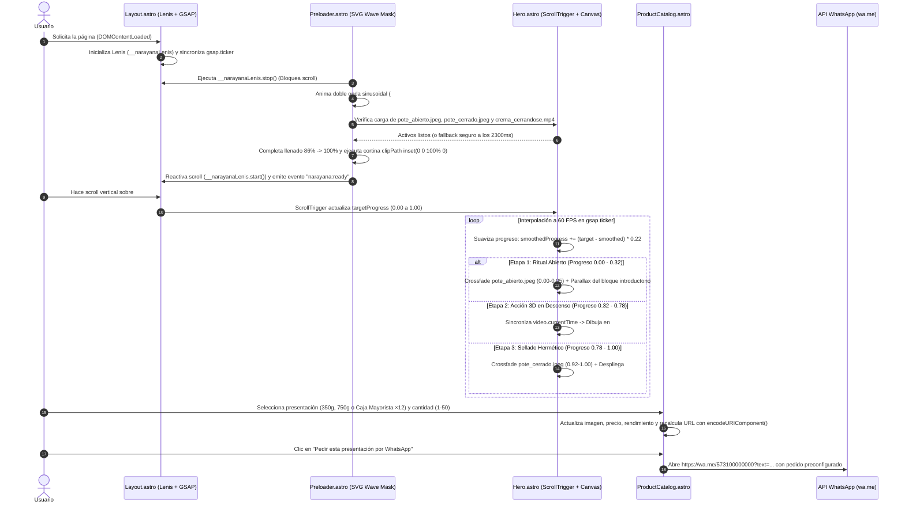

# 🌿 Narayana · Limpiador Multiusos en Crema 3D

> **“El aseo es salud y confort · El equilibrio que cuida de ti”**  
> Plataforma web experiencial de alto impacto para **Narayana** (Código Interno `NRN-001` · Versión `01`), el limpiador multiusos en crema instantáneo y biodegradable creado en Popayán, Cauca (Colombia) para **unir ciencia y conciencia**.

---

## 📋 Tabla de Contenidos

1. [Descripción General y Concepto de Marca](#-1-descripción-general-y-concepto-de-marca)
2. [Stack Tecnológico](#-2-stack-tecnológico)
3. [Arquitectura del Sistema y Diagramas Mermaid](#-3-arquitectura-del-sistema-y-diagramas-mermaid)
4. [Detalle de Componentes e Interacciones](#-4-detalle-de-componentes-e-interacciones)
5. [Inventario de Activos Multimedia y Recorte de Marca de Agua](#-5-inventario-de-activos-multimedia-y-recorte-de-marca-de-agua)
6. [Guía Rápida de Personalización Comercial (`src/config/brand.ts`)](#-6-guía-rápida-de-personalización-comercial-srcconfigbrandts)
7. [Comandos de Desarrollo y Guía de Despliegue](#-7-comandos-de-desarrollo-y-guía-de-despliegue)

---

## 🌿 1. Descripción General y Concepto de Marca

### Concepto Creativo: *"Eco-Zen Sanctuary & Bio-Clean Performance"*

La experiencia digital de **Narayana** traduce la esencia de su origen —la meditación en la naturaleza caucana y el rigor químico de los laboratorios de la **Corporación Universitaria Autónoma del Cauca (Uniautónoma del Cauca)**— en una interfaz inmersiva que combina serenidad botánica con demostración científica de alto rendimiento.

Liderado por su fundador y gerente **Gustavo Bermeo** y respaldado como ganador de **$5.000.000 COP en Capital Semilla de EmprendeLab**, Narayana resuelve tres desafíos críticos del aseo doméstico, comercial e industrial en un solo gesto:

| Pilar Fórmula 3D | Mecanismo Activo | Beneficio Clave | Métrica Oficial (`NRN-001`) |
| :--- | :--- | :--- | :--- |
| **1D · Desengrasa** | Acción alcalina controlada (Carbonato de sodio + Tensioactivos biodegradables) | Emulsiona grasas adheridas en cocinas, campanas, hornos y motores sin vapores tóxicos. | `0% residuos grasos` |
| **2D · Desmancha** | Microgránulos minerales biodegradables (Bicarbonato + Silicato de sodio) | Restaura el blanco original en suelas y cuero de calzado, paredes lavables y acero inoxidable. | `Sin partículas agresivas` |
| **3D · Desinfecta** | Oxígeno activo + Extractos botánicos (Percarbonato de sodio + Fragancia natural) | Elimina microorganismos y malos olores sin cloro, dejando un aroma natural. | `pH 10,5 – 11,5` |

### Pilares Ambientales y Economía Circular

- **Limpieza en Seco (95% Ahorro Hídrico):** Gracias a su baja humedad (`≤ 3%`) y densidad aparente controlada (`0,70 – 0,85 g/mL`), Narayana encapsula la suciedad permitiendo retirarla con un paño de microfibra sin necesidad de mangueras ni baldes de agua.
- **Bioempaque con Fibra de Piña:** Aprovechamiento de residuos agrícolas regionales (fibra de piña) para el desarrollo de empaques secundarios sostenibles bajo un modelo de economía circular.
- **Envase Reutilizable y 100% Libre de Fosfatos:** Pote ergonómico en Polipropileno (`PP`) reciclable y reutilizable que preserva la fórmula durante sus **24 meses de vida útil** sin contaminar las fuentes hídricas.

### Sistema de Diseño y Tokens Visuales (`src/styles/global.css`)

| Categoría | Token Tailwind v4 | Valor Hex / Fuente | Aplicación en la Interfaz |
| :--- | :--- | :--- | :--- |
| **Selva Nocturna** | `--color-canopy-950` / `900` / `800` / `700` | `#04110b` · `#071a12` · `#0d281c` · `#153c2a` | Fondos profundos de santuario botánico y tarjetas glassmorphism (`.glass-canopy`). |
| **Pureza en Crema** | `--color-cream-50` / `100` / `200` | `#f7f9f4` · `#eef3e8` · `#dce6d1` | Secciones luminosas de contraste (`TextureShowcase`, `ProductCatalog`) y textos principales. |
| **Bio-Esmeralda** | `--color-bio-400` / `500` / `600` | `#4ade80` · `#22c55e` · `#16a34a` | Acentos de conversión, indicadores de biodegradabilidad y CTAs de WhatsApp. |
| **Agua Celestial** | `--color-celestial-400` / `500` / `600` | `#38bdf8` · `#0ea5e9` · `#0284c7` | Ondas del preloader líquido, métricas de ahorro hídrico y sellos técnicos. |
| **Energía Social** | `--color-starry-lime` / `--color-solar-400` | `#5ce63c` · `#facc15` | Banner de alta energía estilo *Starry* (`SocialEnergyBanner.astro`) y destellos de 4 puntas. |
| **Tipografía** | `--font-display` / `--font-wordmark` / `--font-sans` | `Syne` · `Outfit` · `Plus Jakarta Sans` | Titulares editoriales, wordmark monumental `narayana` y lectura técnica de alta legibilidad. |

---

## ⚡ 2. Stack Tecnológico

El proyecto está construido sobre una arquitectura estática ultrarrápida orientada a **Core Web Vitals**, animaciones fluidas a **60 FPS** y mantenibilidad centralizada:

| Tecnología | Versión | Rol en la Arquitectura |
| :--- | :--- | :--- |
| **[Astro](https://astro.build/)** | `^5.5.0` | Framework principal de generación estática (SSG) sin sobrecarga de runtime JS innecesario, con inyección de datos estructurados JSON-LD (`Product` / `AggregateOffer`). |
| **[Tailwind CSS v4](https://tailwindcss.com/)** | `^4.1.0` | Motor de estilos CSS-first integrado vía `@tailwindcss/vite`, con definición de tokens de marca en `@theme` y utilidades personalizadas (`.glass-canopy`, `.watermark-crop-frame`, `.starry-display-stroke`). |
| **[GSAP 3](https://gsap.com/)** | `^3.12.7` | Motor de animación profesional junto con el plugin **`ScrollTrigger`** para el preloader líquido sinusoidal, el scroll-scrubbing del Hero y micro-interacciones continuas en `gsap.ticker`. |
| **[Lenis](https://lenis.darkroom.engineering/)** | `^1.2.3` | Smooth scroll inercial sincronizado al milisegundo con `gsap.ticker` y `ScrollTrigger.update`, con respeto automático a `prefers-reduced-motion: reduce`. |
| **[TypeScript](https://www.typescriptlang.org/)** | `Strict` | Tipado estricto (`astro/tsconfigs/strict`) para las interfaces del producto, composición química, parámetros fisicoquímicos y generador de enlaces de WhatsApp en `src/config/brand.ts`. |

---

## 🧩 3. Arquitectura del Sistema y Diagramas Mermaid

### 3.1. Diagrama de Arquitectura de Componentes (`flowchart TD`)

El siguiente diagrama representa la jerarquía exacta de archivos implementada en `/src`, mostrando cómo la fuente única de verdad (`src/config/brand.ts`) y la hoja de estilos global (`src/styles/global.css`) alimentan el layout base, la página principal y los **12 componentes modulares**:

```mermaid
flowchart TD
  subgraph Config["Capa de Datos y Estilos Globales"]
    BrandTS["src/config/brand.ts<br/>(BRAND_CONFIG + buildWhatsAppUrl)"]
    GlobalCSS["src/styles/global.css<br/>(@theme Tailwind v4 + .watermark-crop-frame)"]
  end

  subgraph Core[" Núcleo de Página y Motor de Scroll"]
    Layout["src/layouts/Layout.astro<br/>(SEO, JSON-LD, Preload, Lenis + GSAP Ticker)"]
    Index["src/pages/index.astro<br/>(Orquestador de la Landing Page)"]
  end

  subgraph UI["12 Componentes de Experiencia (src/components/)"]
    Preloader["Preloader.astro<br/>(Onda líquida SVG + Contador 0-100%)"]
    Navbar["Navbar.astro<br/>(Navegación Glassmorphism + Drawer Móvil)"]
    Hero["Hero.astro<br/>(Scroll-Scrubbing 3 Etapas + Canvas Buffer)"]
    Exp3D["Experience3D.astro<br/>(Video Ambiental + 3 Pilares + Simulador Agua)"]
    Texture["TextureShowcase.astro<br/>(Macro Crema + 7 Hotspots Químicos)"]
    Slider["BeforeAfterSlider.astro<br/>(Inspector Calzado Antes/Después + 6 Superficies)"]
    Story["StorySection.astro<br/>(Cine Documental con Audio + 3 Capítulos)"]
    Tech["TechSpecs.astro<br/>(Economía Circular + Tablas NRN-001 + Modal Zoom)"]
    Catalog["ProductCatalog.astro<br/>(Configurador 350g / 750g / Mayorista B2B)"]
    Social["SocialEnergyBanner.astro<br/>(Banner Starry Lime + Redes Sociales)"]
    Footer["Footer.astro<br/>(Precauciones, Almacenamiento y Cierre)"]
    FloatWA["WhatsAppFloatingCTA.astro<br/>(Botón Flotante Permanente z-50)"]
  end

  BrandTS --> Layout
  GlobalCSS --> Layout
  Layout --> Index

  Index --> Preloader
  Index --> Navbar
  Index --> Hero
  Index --> Exp3D
  Index --> Texture
  Index --> Slider
  Index --> Story
  Index --> Tech
  Index --> Catalog
  Index --> Social
  Index --> Footer
  Index --> FloatWA

  BrandTS -. "Datos, Precios y Links WA" .-> Preloader
  BrandTS -. "Datos, Precios y Links WA" .-> Navbar
  BrandTS -. "Datos, Precios y Links WA" .-> Hero
  BrandTS -. "Datos, Precios y Links WA" .-> Exp3D
  BrandTS -. "Datos, Precios y Links WA" .-> Texture
  BrandTS -. "Datos, Precios y Links WA" .-> Slider
  BrandTS -. "Datos, Precios y Links WA" .-> Story
  BrandTS -. "Datos, Precios y Links WA" .-> Tech
  BrandTS -. "Datos, Precios y Links WA" .-> Catalog
  BrandTS -. "Datos, Precios y Links WA" .-> Social
  BrandTS -. "Datos, Precios y Links WA" .-> Footer
  BrandTS -. "buildWhatsAppUrl()" .-> FloatWA
```



---

### 3.2. Flujo de Animación: Preloader Líquido, Hero Scroll-Scrubbing y Conversión (`sequenceDiagram`)

El siguiente diagrama de secuencia detalla el ciclo de vida interactivo desde que el usuario ingresa a la página hasta el cierre del pedido en WhatsApp:



---

## 🖥️ 4. Detalle de Componentes e Interacciones

Cada componente dentro de `src/components/` cumple una función específica respaldada por la **Ficha Técnica Oficial `NRN-001`**:

1. **[`Preloader.astro`](file:///Users/salomontilla/Fabrica_Software/narayana/src/components/Preloader.astro) (Inspiración `jazakvoda.rs` & `loading_screen.jpeg`):**
   - Construye una máscara vectorial SVG (`#narayana-wordmark-mask`) compuesta por el isotipo del loto meditando y el wordmark monumental `narayana` en minúsculas (`Outfit 800`).
   - En cada ciclo de `gsap.ticker`, genera dinámicamente dos curvas sinusoidales desfasadas (`#preloader-wave-crest` en blanco espuma y `#preloader-wave-body` con gradiente bio-celestial `#narayana-liquid-grad`) que ascienden desde `Y = 250` hasta `Y = -15` mientras el contador numérico avanza de `0%` a `100%`.
   - Espera la carga real de los activos críticos del Hero (`pote_abierto.jpeg`, `pote_cerrado.jpeg` y `crema_cerrandose.mp4`) con un tiempo mínimo estético de `1250ms` y un *timeout* máximo de seguridad de `2300ms`.

2. **[`Navbar.astro`](file:///Users/salomontilla/Fabrica_Software/narayana/src/components/Navbar.astro):**
   - Barra flotante con efecto `.glass-canopy`, acceso rápido a las 7 secciones mediante desplazamiento suave con Lenis (`offset: -72px`), CTA directo de WhatsApp y menú móvil desplegable accesible por teclado (`Escape` y atributos `aria-expanded`).

3. **[`Hero.astro`](file:///Users/salomontilla/Fabrica_Software/narayana/src/components/Hero.astro) (`#el-ritual`):**
   - Fija el viewport durante `+=220%` de recorrido vertical usando `ScrollTrigger`.
   - **Arquitectura Híbrida de Medios:** Combina `pote_abierto.jpeg` en el arranque (`0.00 – 0.05`), el video `crema_cerrandose.mp4` volcado en tiempo real a un `<canvas id="hero-scrub-canvas">` para evitar parpadeos de decodificación, y `pote_cerrado.jpeg` en el sellado final (`0.92 – 1.00`).
   - Incluye barra HUD inferior en vivo con porcentaje (`0% – 100%`) y estado narrativo del envase.

4. **[`Experience3D.astro`](file:///Users/salomontilla/Fabrica_Software/narayana/src/components/Experience3D.astro) (`#formula-3d`):**
   - Presenta el bucle atmosférico `hoja_la_crema.mp4`, las tarjetas de los 3 pilares (**1D Desengrasa**, **2D Desmancha**, **3D Desinfecta**), los 5 sellos oficiales de certificación y una **Calculadora Interactiva de Ahorro Hídrico** (`#water-calc-range`) que estima los litros de agua ahorrados al mes (`usos_semanales × 4.3 × 11`).

5. **[`TextureShowcase.astro`](file:///Users/salomontilla/Fabrica_Software/narayana/src/components/TextureShowcase.astro) (`#textura-composicion`):**
   - Fotografías macro de la crema (`crema_primer_plano.png`) con **7 pines interactivos (hotspots)** posicionados mediante coordenadas porcentuales (`coordX`, `coordY`) que sincronizan la tarjeta flotante y la tabla de **Composición Cualitativa** (Sección 2 de la Ficha Técnica `NRN-001`).

6. **[`BeforeAfterSlider.astro`](file:///Users/salomontilla/Fabrica_Software/narayana/src/components/BeforeAfterSlider.astro) (`#demostracion`):**
   - **Inspector Interactivo de Calzado:** Deslizador accesible (`<input type="range" min="8" max="92">`) que controla en tiempo real el `clip-path: inset(0 X% 0 0)` sobre `zapato_limpiando.jpeg`, contrastando la zona con barro adherido frente al cuero blanco restaurado en seco.
   - Incorpora el **Modo de Uso Oficial en 4 Pasos** (Sección 6) y la cuadrícula de **6 Superficies Recomendadas** (Sección 7: Calzado, Cocinas, Acero Inoxidable, Baños, Paredes Lavables y Utensilios).

7. **[`StorySection.astro`](file:///Users/salomontilla/Fabrica_Software/narayana/src/components/StorySection.astro) (`#historia`):**
   - **Sala de Cine Documental:** Reproductor personalizado para `historia_narayana.mp4` (`01:11` con audio original de Gustavo Bermeo y el equipo de la Uniautónoma del Cauca), con botón central de activación con sonido, barra de progreso interactiva y **3 marcadores de capítulos** (`00:00 Raíces en el hogar y la maloka`, `00:22 Laboratorio Uniautónoma del Cauca`, `00:46 Ganadores EmprendeLab $5.000.000`).
   - Complementado por dos tarjetas de video ambiental en bucle: `persona_meditando.mp4` y `hands_holding_cream.mp4`.

8. **[`TechSpecs.astro`](file:///Users/salomontilla/Fabrica_Software/narayana/src/components/TechSpecs.astro) (`#ficha-tecnica`):**
   - Destaca los 3 pilares de **Información Ambiental y Economía Circular** (Sección 10: Fibra de piña para bioempaque, Polipropileno PP reciclable y fórmula libre de fosfatos).
   - Renderiza las tablas de **Características Fisicoquímicas** (Sección 3) e **Información Logística** (Sección 12), además de un **Visor Modal de Alta Resolución** (`#manual-modal` con `data-lenis-prevent`) y botón de descarga directa para `manual_narayana.png`.

9. **[`ProductCatalog.astro`](file:///Users/salomontilla/Fabrica_Software/narayana/src/components/ProductCatalog.astro) (`#presentaciones`):**
   - Configurador comercial B2C y B2B con 4 tarjetas selectoras (`350g`, `750g`, `Caja Distribuidor 12 × 350g`, `Caja Institucional 12 × 750g`), selector de cantidad (`1` a `50`) y generación dinámica del mensaje de pedido hacia WhatsApp.

10. **[`SocialEnergyBanner.astro`](file:///Users/salomontilla/Fabrica_Software/narayana/src/components/SocialEnergyBanner.astro) (`#comunidad-narayana`):**
    - Homenaje visual directo a la referencia de alta energía (*Starry Lemon Lime*): fondo verde lima vibrante (`#5CE63C`), tarjeta de producto inclinada con levitación continua en GSAP (`#starry-floating-jar`), cascada de destellos amarillos de 4 puntas (`.starry-sparkle`), tipografía monumental `.starry-display-stroke` (*"SOMOS CONCIENCIA EN ACCIÓN"*) y píldoras hacia TikTok, Instagram, YouTube, Facebook y WhatsApp.

11. **[`Footer.astro`](file:///Users/salomontilla/Fabrica_Software/narayana/src/components/Footer.astro) y [`WhatsAppFloatingCTA.astro`](file:///Users/salomontilla/Fabrica_Software/narayana/src/components/WhatsAppFloatingCTA.astro):**
    - El `Footer` integra los bloques oficiales **8. Precauciones y Advertencias de Uso** y **9. Condiciones de Almacenamiento** (`5 – 35 °C`), enlaces de navegación y botón mayorista B2B.
    - `WhatsAppFloatingCTA` mantiene un acceso permanente en la esquina inferior derecha (`z-50`) durante todo el recorrido.

---

## 🎬 5. Inventario de Activos Multimedia y Recorte de Marca de Agua

Todos los activos de producción se sirven estáticamente desde `public/assets/` y provienen de los archivos maestros curados en `image_sources/`.

### 5.1. Inventario de Videos (`public/assets/videos/`)

| Archivo Público | Fuente Original (`image_sources/`) | Peso | Audio | Componente | Rol Técnico y Narrativo | Recorte `.watermark-crop-frame` |
| :--- | :--- | :---: | :---: | :--- | :--- | :---: |
| [`crema_cerrandose.mp4`](file:///Users/salomontilla/Fabrica_Software/narayana/public/assets/videos/crema_cerrandose.mp4) | `crema_cerrandose.mp4` | `2.1 MB` | Mute | `Hero.astro` | Video principal de scroll-scrubbing (tapa verde descendiendo y sellando el pote sobre hoja de monstera). | ✅ Sí (`1.085x`) |
| [`hoja_la_crema.mp4`](file:///Users/salomontilla/Fabrica_Software/narayana/public/assets/videos/hoja_la_crema.mp4) | `hoja_la_crema.mp4` | `3.3 MB` | Mute | `Experience3D.astro` | Bucle atmosférico del envase en la selva junto a los 3 pilares de la Fórmula 3D. | ✅ Sí (`1.085x`) |
| [`historia_narayana.mp4`](file:///Users/salomontilla/Fabrica_Software/narayana/public/assets/videos/historia_narayana.mp4) | `historia_narayana.mp4` | `12.0 MB` | **Estéreo (AAC)** | `StorySection.astro` | Documental oficial (`01:11`, `1920×1080`) con testimonios de Gustavo Bermeo y la Uniautónoma del Cauca. | ❌ No (Frame limpio 16:9) |
| [`persona_meditando.mp4`](file:///Users/salomontilla/Fabrica_Software/narayana/public/assets/videos/persona_meditando.mp4) | `persona_meditando.mp4` | `7.1 MB` | Mute | `StorySection.astro` | Bucle de conexión espiritual y meditación en sendero hacia la maloka caucana. | ✅ Sí (`1.085x`) |
| [`hands_holding_cream.mp4`](file:///Users/salomontilla/Fabrica_Software/narayana/public/assets/videos/hands_holding_cream.mp4) | `Hands_holding_cleaning_cream_con…_ba20eea9_1080p.mp4` | `2.8 MB` | Mute | `StorySection.astro` | Bucle de manos sosteniendo y ofreciendo el envase de Narayana con luz solar natural. | ✅ Sí (`1.085x`) |

### 5.2. Inventario de Imágenes (`public/assets/images/`)

| Archivo Público | Fuente Original (`image_sources/`) | Peso | Componente(s) | Rol Técnico y Narrativo |
| :--- | :--- | :---: | :--- | :--- |
| [`pote_abierto.jpeg`](file:///Users/salomontilla/Fabrica_Software/narayana/public/assets/images/pote_abierto.jpeg) | `pote_abierto.jpeg` | `2.2 MB` | `Layout.astro`, `Preloader.astro`, `Hero.astro` | Frame inicial de alta resolución (`0.00 – 0.05` del Hero) con tapa levitando + imagen OpenGraph y `preload` LCP. |
| [`pote_cerrado.jpeg`](file:///Users/salomontilla/Fabrica_Software/narayana/public/assets/images/pote_cerrado.jpeg) | `pote_cerrado.jpeg` | `2.1 MB` | `Layout.astro`, `Preloader.astro`, `Hero.astro`, `ProductCatalog.astro` | Frame final de alta resolución (`0.92 – 1.00` del Hero) con envase sellado + imagen de la presentación **350 g**. |
| [`crema_primer_plano.png`](file:///Users/salomontilla/Fabrica_Software/narayana/public/assets/images/crema_primer_plano.png) | `crema_primer_plano.png` | `1.9 MB` | `TextureShowcase.astro`, `ProductCatalog.astro`, `SocialEnergyBanner.astro` | Fotografía macro de la crema blanca suave con gotas de rocío (escenario de los 7 hotspots químicos, presentación **750 g** y jarra flotante). |
| [`zapato_limpiando.jpeg`](file:///Users/salomontilla/Fabrica_Software/narayana/public/assets/images/zapato_limpiando.jpeg) | `zapato_limpiando.jpeg` | `2.6 MB` | `BeforeAfterSlider.astro` | Fotografía real de limpieza en seco sobre calzado deportivo (mitad barro / mitad blanco impecable). |
| [`manual_narayana.png`](file:///Users/salomontilla/Fabrica_Software/narayana/public/assets/images/manual_narayana.png) | `manual_narayana.png` | `2.1 MB` | `TechSpecs.astro` | Ficha Técnica Oficial de Producto (`NRN-001`) para inspección en modal de alta resolución y descarga directa. |
| [`packshot_selva.png`](file:///Users/salomontilla/Fabrica_Software/narayana/public/assets/images/packshot_selva.png) | `C3395.00_00_56_077.Imagen fija008.png` | `2.4 MB` | `ProductCatalog.astro` | Imagen oficial para la **Caja Distribuidor 12 × 350 g** en el configurador de pedidos. |
| [`manos_ofrenda.png`](file:///Users/salomontilla/Fabrica_Software/narayana/public/assets/images/manos_ofrenda.png) | `C3395.00_00_54_004.Imagen fija001.png` | `2.1 MB` | `StorySection.astro`, `ProductCatalog.astro` | Póster del video `hands_holding_cream.mp4` e imagen de la **Caja Institucional 12 × 750 g**. |
| [`meditacion_selva.png`](file:///Users/salomontilla/Fabrica_Software/narayana/public/assets/images/meditacion_selva.png) | `C3395.00_00_03_098.Imagen fija006.png` | `10.0 MB` | `StorySection.astro` | Póster cinematográfico del documental principal `historia_narayana.mp4`. |
| [`sendero_maloka_1.png`](file:///Users/salomontilla/Fabrica_Software/narayana/public/assets/images/sendero_maloka_1.png) | `C3395.00_00_07_087.Imagen fija005.png` | `2.2 MB` | `Experience3D.astro` | Póster de carga instantánea para el video `hoja_la_crema.mp4`. |
| [`sendero_maloka_2.png`](file:///Users/salomontilla/Fabrica_Software/narayana/public/assets/images/sendero_maloka_2.png) | `C3395.00_00_54_105.Imagen fija002.png` | `3.1 MB` | `StorySection.astro` | Póster de carga instantánea para el video `persona_meditando.mp4`. |

---

### 5.3. Procesamiento de Recorte de Marca de Agua (`.watermark-crop-frame`)

Los activos generados con **KlingAI 4.0** (`pote_abierto.jpeg`, `pote_cerrado.jpeg`, `crema_cerrandose.mp4`, `hoja_la_crema.mp4`, `persona_meditando.mp4` y `hands_holding_cream.mp4`) contienen una marca de agua en el extremo inferior derecho del archivo fuente.

Para eliminarla **al 100% en todos los tamaños de pantalla** sin necesidad de recodificar ni degradar la calidad de los videos originales, se implementó el sistema de recorte geométrico en [`src/styles/global.css`](file:///Users/salomontilla/Fabrica_Software/narayana/src/styles/global.css#L68-L82):

```css
/* Watermark-safe cropping frame for Hero & video assets (crops KlingAI 4.0 bottom-right 100%) */
.watermark-crop-frame {
  overflow: hidden;
  position: relative;
}

.watermark-crop-media {
  width: 100%;
  height: 100%;
  object-fit: cover;
  object-position: center 42%;
  transform: scale(1.085);
  transform-origin: center 42%;
  will-change: transform, opacity;
}
```

> [!TIP]
> **¿Por qué `center 42%` y `scale(1.085)`?**  
> Al desplazar ligeramente el punto de anclaje vertical al `42%` (en lugar del `50%` estándar) y aplicar un escalado del `8.5%` desde ese mismo origen, el borde inferior derecho —donde se ubica la marca de agua de KlingAI— queda desplazado completamente fuera de la caja de recorte (`overflow: hidden`), mientras que la tapa verde flotante y el cuerpo del envase Narayana permanecen perfectamente centrados en la zona áurea del viewport.

---

## 🛠️ 6. Guía Rápida de Personalización Comercial (`src/config/brand.ts`)

Toda la información comercial, de contacto, precios, presentaciones y ficha técnica está centralizada en un único archivo: **[`src/config/brand.ts`](file:///Users/salomontilla/Fabrica_Software/narayana/src/config/brand.ts)**. Cualquier cambio realizado allí se propaga automáticamente al `Navbar`, `Hero`, `BeforeAfterSlider`, `ProductCatalog`, `SocialEnergyBanner`, `Footer`, `WhatsAppFloatingCTA` y a los metadatos SEO/JSON-LD.

### 6.1. Actualizar Número de WhatsApp y Mensajes Predeterminados

Abre [`src/config/brand.ts`](file:///Users/salomontilla/Fabrica_Software/narayana/src/config/brand.ts#L69-L79) y edita el bloque `contact`:

```ts
contact: {
  // Número en formato internacional sin el signo "+" ni espacios (Ej: Colombia 57 + 10 dígitos)
  whatsappNumber: '573100000000',
  whatsappDisplay: '+57 (310) 000-0000',
  defaultWhatsappMessage:
    'Hola equipo Narayana 🌿, vengo de la página web y quiero conocer precios y disponibilidad del limpiador multiusos en crema (350g / 750g).',
  distributorWhatsappMessage:
    'Hola Gustavo y equipo Narayana 🌿, me interesa adquirir la Caja Mayorista (12 unidades) o ser distribuidor autorizado en mi ciudad.',
  email: 'contacto@narayanabioclean.com',
  location: 'Popayán, Cauca — Envíos a toda Colombia',
},
```

### 6.2. Actualizar Precios y Presentaciones (`350g`, `750g` y Cajas Mayoristas)

En [`src/config/brand.ts`](file:///Users/salomontilla/Fabrica_Software/narayana/src/config/brand.ts#L269-L347), localiza el arreglo `presentations` y modifica `priceFormatted`, `priceNote`, `yieldEstimate` o `whatsappText` según tu lista de precios vigente:

```ts
presentations: [
  {
    id: '350g',
    name: 'Narayana Hogar 350 g',
    weight: '350 g',
    badge: 'Ideal para probar el ritual',
    priceFormatted: '$18.000 COP', // <-- Cambia el precio visible aquí
    priceNote: 'Precio de referencia sugerido · Consulta promociones vigentes',
    unitsIncluded: 1,
    // ...
  },
  {
    id: '750g',
    name: 'Narayana Rendimiento 750 g',
    weight: '750 g',
    badge: 'Más elegido · Mejor costo por gramo',
    priceFormatted: '$32.000 COP', // <-- Cambia el precio de 750g aquí
    priceNote: 'Ahorra más del 18% por gramo frente al formato pequeño',
    unitsIncluded: 1,
    popular: true,
    // ...
  },
  // 'mayorista-350g' (Caja 12 × 350 g) y 'mayorista-750g' (Caja 12 × 750 g)
]
```

> [!NOTE]
> Si también deseas actualizar el rango de precios reportado a Google en los resultados enriquecidos (Rich Snippets), actualiza `lowPrice` y `highPrice` dentro del bloque `application/ld+json` en [`src/layouts/Layout.astro`](file:///Users/salomontilla/Fabrica_Software/narayana/src/layouts/Layout.astro#L60-L67).

### 6.3. Actualizar Redes Sociales Oficiales

En [`src/config/brand.ts`](file:///Users/salomontilla/Fabrica_Software/narayana/src/config/brand.ts#L80-L85), edita el objeto `socials` para reflejar los perfiles oficiales de la marca:

```ts
socials: {
  tiktok: 'https://www.tiktok.com/@narayana.col',
  instagram: 'https://www.instagram.com/narayana.col',
  youtube: 'https://www.youtube.com/@narayana.col',
  facebook: 'https://www.facebook.com/narayana.col',
},
```

---

## 🚀 7. Comandos de Desarrollo y Guía de Despliegue

### 7.1. Requisitos Previos e Instalación Local

- **Node.js:** `>= 18.20.8` o `>= 20.3.0` (recomendado Node 20 LTS o 22 LTS).
- **Gestor de paquetes:** `npm` (incluido con Node.js).

```bash
# 1. Instalar dependencias del proyecto
npm install

# 2. Iniciar servidor de desarrollo con Hot Module Replacement (http://localhost:4321)
npm run dev

# 3. Generar el build estático optimizado para producción en ./dist
npm run build

# 4. Previsualizar localmente el build de producción
npm run preview
```

### 7.2. Comandos NPM Disponibles (`package.json`)

| Comando | Acción |
| :--- | :--- |
| `npm run dev` / `npm start` | Inicia el servidor de desarrollo de Astro en `http://localhost:4321`. |
| `npm run build` | Compila y empaqueta el sitio estático de producción en el directorio `dist/`. |
| `npm run preview` | Sirve localmente el contenido compilado en `dist/` para validación pre-despliegue. |
| `npm run astro` | Ejecuta el CLI de Astro directamente (ej. `npm run astro check` o `npm run astro info`). |

---

### 7.3. Despliegue en Producción (Static Hosting / Edge CDN)

Dado que el proyecto genera una salida 100% estática (`dist/`) sin dependencias de servidor Node en tiempo de ejecución, puede desplegarse gratuitamente y con CDN global en cualquiera de las siguientes plataformas:

| Plataforma | Framework Preset | Build Command | Output Directory | Variable de Entorno Recomendada |
| :--- | :--- | :--- | :--- | :--- |
| **Vercel** | `Astro` | `npm run build` | `dist` | `NODE_VERSION = 20` |
| **Netlify** | `Astro` | `npm run build` | `dist` | `NODE_VERSION = 20` |
| **Cloudflare Pages** | `Astro` | `npm run build` | `dist` | `NODE_VERSION = 20` |
| **Coolify (Nixpacks / Static)** | `Static / Astro` | `npm run build` | `dist` | `NIXPACKS_NODE_VERSION = 20` |

#### Despliegue Rápido por CLI

- **Vercel:**
  ```bash
  npx vercel --prod
  ```
- **Netlify:**
  ```bash
  npx netlify-cli deploy --build --prod --dir=dist
  ```
- **Cloudflare Pages (Wrangler):**
  ```bash
  npm run build && npx wrangler pages deploy dist --project-name=narayana-web
  ```

---

<div align="center">
  <p><strong>Narayana · Limpiador Multiusos en Crema 3D (Código NRN-001)</strong></p>
  <p><em>“Unir ciencia y conciencia · El aseo es salud y confort”</em> · Popayán, Cauca, Colombia 🌿</p>
</div>
